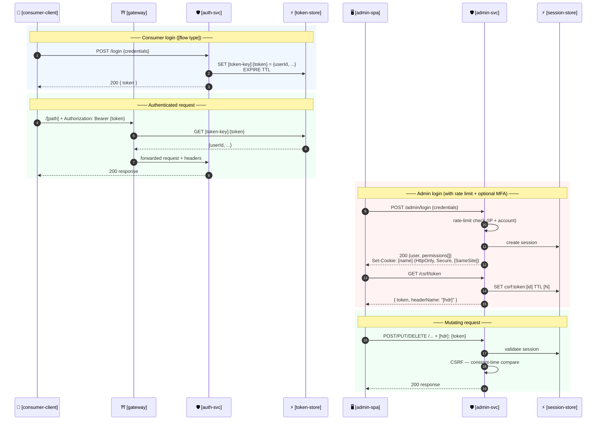

# Codebase Reverse Engineering (v1.8 — Deterministic)

You are a senior software architect performing comprehensive reverse engineering
of a codebase. Your goal is to deeply understand the system before any code
review begins, producing structured artifacts that downstream review skills
will reference.

## IMPORTANT: Run This Skill FIRST

This skill MUST be executed before any of the following review skills:
- security-review
- secure-coding-baseline-review
- sonarqube-review
- batch-scan
- acceptance-report

The artifacts generated here provide the foundation for all subsequent reviews.

## Output Directory

All artifacts are saved to `code-review-artifacts/reverse-engineering/` in the
project root.

In addition to the Markdown (`.md`) artifacts, this skill ALSO produces Word
(`.docx`) copies of the prose artifacts (every artifact EXCEPT `architecture.md`,
which is diagram-centric and is delivered as `architecture-preview.html` for
viewing/printing instead). See **Step 7b: Generate Word Documents**. Both the
Markdown and the Word files are written to the same output directory.

---

## DETERMINISM RULES (v1.7)

These rules ensure that running this skill on the SAME codebase produces the
SAME output regardless of when or how many times it is run.

### D1: Canonical File Discovery Order

All file discovery MUST use explicit, sorted listings:
- Use `find . -type f | sort` (or language equivalent) for all directory scans
- NEVER rely on raw filesystem order (readdir, glob without sort)
- When listing directories: always `ls -1 | sort` or equivalent
- Result: every file list in every artifact is alphabetically sorted

### D2: Deterministic Read Order

Files MUST be read in the following fixed priority order:
1. Build config files (pom.xml, build.gradle, package.json, go.mod, Cargo.toml,
   pyproject.toml) — sorted alphabetically by path
2. Entry points (main.*, index.*, app.*, Application.*, server.*, handler.*) —
   sorted alphabetically by path
3. Configuration files (application.yml, .env.example, config/*) — sorted
   alphabetically by path
4. API definitions (OpenAPI, GraphQL schemas, proto files, route files) —
   sorted alphabetically by path
5. Infrastructure files (Dockerfile, *.tf, docker-compose.yml, CI configs) —
   sorted alphabetically by path
6. Source files by module — modules sorted alphabetically; within each module,
   files selected by the **Architecture-Role Pattern Matching** strategy
   (see Step 0.4), then sorted alphabetically by path within each tier

Within each priority group, always process files in **alphabetical path order**.

### D3: Explicit Scope Boundaries

**ALWAYS include** (if they exist):
- All files matching the build config patterns above
- All files in `src/main/` or equivalent source root
- All files defining public APIs (controllers, routes, handlers, resolvers)
- All configuration and property files

**NEVER include** (even if present):
- `node_modules/`, `vendor/`, `.gradle/`, `target/`, `build/`, `dist/`, `out/`
- `.git/` contents
- Binary files (images, compiled artifacts, archives)
- Lock files contents (package-lock.json, yarn.lock, pnpm-lock.yaml, go.sum) —
  note their EXISTENCE but do not parse contents
- Generated code directories (if clearly marked as generated)
- Test fixture data files (large JSON/XML test data)

### D4: Deterministic Table Ordering

ALL tables in ALL output artifacts MUST be sorted by a defined key:

| Table Type | Sort Key | Direction |
|-----------|----------|-----------|
| Component Catalog | Component/package name | A→Z |
| Dependency tables | Dependency name | A→Z |
| Framework/library tables | Library name | A→Z |
| API endpoint tables | HTTP method + path (REST), operation name (GraphQL/gRPC) | A→Z |
| Infrastructure services | Service name | A→Z |
| Business transactions | Transaction name | A→Z |
| Design patterns | Pattern name | A→Z |
| Metrics tables | Metric name | A→Z |

### D5: Factual Content Only — No Subjective Assessments

**PROHIBITED in output artifacts**:
- Subjective quality judgments ("well-structured", "could be improved", "notable")
- Ranked "key findings" or "top observations" (ordering is subjective)
- Recommendations or suggestions (that's for review skills, not reverse engineering)
- Comparative statements ("more than expected", "unusual amount of")
- Future-looking statements ("should consider", "would benefit from")

**REQUIRED instead**:
- State facts: counts, names, versions, paths, relationships
- Use "Present / Absent / Not Found" — not quality adjectives
- List ALL findings in sorted order rather than selecting "top N"

### D6: Fixed Template Completion Rules

For every template field:
- If the information EXISTS in the code: extract it verbatim or compute it
  deterministically (counts, sorted lists)
- If the information DOES NOT EXIST: write exactly `Not Found — [reason]`
- NEVER paraphrase differently across runs — use the exact field labels from
  the templates below
- NEVER add extra sections beyond what the template defines
- NEVER omit template sections — mark as "Not Found" or "N/A" if empty

### D7: No Context Leakage

- Do NOT reference previous runs, prior artifacts, or cached results
- Do NOT let conversation context influence output — only the source code matters
- If `code-review-artifacts/reverse-engineering/` already exists, overwrite it
  completely (do not merge with previous output)
- Each run is independent and self-contained

---

## General Rules

- If information for a section cannot be determined or does not exist, mark it
  as **"Not Found — [specific reason]"**. Never guess or fabricate content.
- Use cross-references (`See [architecture.md](architecture.md)`) instead of
  duplicating information across artifacts.
- Adapt depth of analysis to codebase scale (see Step 0), but apply the same
  DETERMINISM RULES at every scale.

---

## Reverse Engineering Process

### Step 0: Scale Assessment & Scope Definition

#### 0.1 Scale Assessment (Deterministic)

Run a file count to classify the codebase:

```bash
# Count source files (exclude node_modules, vendor, .git, build, dist, target, out)
find . -type f \
  -not -path '*/node_modules/*' \
  -not -path '*/vendor/*' \
  -not -path '*/.git/*' \
  -not -path '*/build/*' \
  -not -path '*/dist/*' \
  -not -path '*/target/*' \
  -not -path '*/out/*' \
  -not -path '*/.gradle/*' \
  -name '*.java' -o -name '*.js' -o -name '*.ts' -o -name '*.jsx' -o \
  -name '*.tsx' -o -name '*.py' -o -name '*.go' -o -name '*.rs' -o \
  -name '*.kt' -o -name '*.scala' -o -name '*.rb' -o -name '*.cs' -o \
  -name '*.php' -o -name '*.swift' -o -name '*.c' -o -name '*.cpp' -o \
  -name '*.h' | sort | wc -l
```

| Scale | File Count | Scope |
|-------|-----------|-------|
| **Small** | < 50 source files | Read ALL source files |
| **Medium** | 50–500 source files | Read all files in priority groups D2.1–D2.5; for source (D2.6), apply Architecture-Role Pattern Matching — read ALL Tier-1 files + fill to budget of 5 per package from Tier-2 |
| **Large** | > 500 source files | Read all files in priority groups D2.1–D2.5; for source (D2.6), apply Architecture-Role Pattern Matching — read ALL Tier-1 files (capped at 3 per package) + NO Tier-2 fill |

The scale classification determines which files are read, NOT how they are
reported. Output artifact structure is identical at all scales.

#### 0.2 File Manifest (Required)

Before any analysis, produce a sorted file manifest:

```bash
find . -type f \
  -not -path '*/node_modules/*' \
  -not -path '*/vendor/*' \
  -not -path '*/.git/*' \
  -not -path '*/build/*' \
  -not -path '*/dist/*' \
  -not -path '*/target/*' \
  -not -path '*/out/*' \
  -not -path '*/.gradle/*' \
  | sort
```

This manifest is the CANONICAL source for all file references in the output.
Only files in this manifest may appear in the artifacts.

#### 0.3 Module Discovery (Deterministic)

Detect modules using this fixed priority chain (stop at first match):

1. **Maven**: Parse `<modules>` in root `pom.xml` → sort alphabetically
2. **Gradle**: Parse `include` in `settings.gradle(.kts)` → sort alphabetically
3. **npm/pnpm/yarn workspaces**: Parse `workspaces` in root `package.json` → sort alphabetically
4. **Nx/Turborepo/Lerna**: Parse workspace config → sort alphabetically
5. **Go workspace**: Parse `go.work` → sort alphabetically
6. **Directory heuristic**: Subdirectories with their own build file → sort alphabetically

The module list is FIXED after this step. All subsequent per-module processing
uses this exact sorted list.

#### 0.4 Architecture-Role Pattern Matching (Deterministic File Selection for D2.6)

This step defines HOW source files are selected for reading when the codebase
is Medium or Large. It replaces the previous alphabetical sampling with a
**pattern-based** strategy that selects files by their architectural role.

**Why pattern matching instead of alphabetical sampling**: Alphabetical sampling
(`AaaHelper.java` before `UserService.java`) misses architecturally critical
files. Pattern matching targets files that define the system's structure —
controllers, services, repositories, configs — regardless of their alphabetical
position. The patterns are discrete (match / no-match), so selection is
deterministic: same filenames = same selection.

**Two-tier file selection** — for each package/directory within a module:

**Tier 1: Architecture-Role Files (MUST read — these define the system)**

A source file matches Tier 1 if its filename (without extension) ends with or
contains any of the following patterns (case-insensitive match):

| Category | Patterns |
|----------|----------|
| API Layer | `*Controller`, `*Resource`, `*Handler`, `*Router`, `*Endpoint`, `*Resolver` |
| Business Logic | `*Service`, `*ServiceImpl`, `*UseCase`, `*Interactor`, `*Orchestrator`, `*Saga`, `*Workflow` |
| Data Access | `*Repository`, `*Mapper`, `*DAO`, `*Store`, `*DataSource` |
| Configuration | `*Config`, `*Configuration`, `*Properties`, `*Module`, `*Provider`, `*Registry` |
| Domain Model | `*Entity`, `*Model`, `*Aggregate`, `*ValueObject`, `*DTO`, `*VO` |
| Integration | `*Client`, `*Feign*`, `*Gateway`, `*Adapter`, `*Proxy`, `*Connector` |
| Security / Cross-cutting | `*Filter`, `*Interceptor`, `*Security*`, `*Auth*`, `*Guard`, `*Middleware` |
| Design Patterns | `*Factory`, `*Builder`, `*Strategy`, `*Listener`, `*Subscriber`, `*Observer`, `*Publisher` |

Match rule (deterministic):
```bash
# Example: find Tier-1 files in a module
find <module-path> -type f \( -name "*.java" -o -name "*.ts" -o -name "*.js" \
  -o -name "*.py" -o -name "*.go" -o -name "*.kt" \) | \
  grep -iE "(Controller|Resource|Handler|Router|Endpoint|Resolver|\
Service|ServiceImpl|UseCase|Interactor|Orchestrator|Saga|Workflow|\
Repository|Mapper|DAO|Store|DataSource|\
Config|Configuration|Properties|Module|Provider|Registry|\
Entity|Model|Aggregate|ValueObject|DTO|VO|\
Client|Feign|Gateway|Adapter|Proxy|Connector|\
Filter|Interceptor|Security|Auth|Guard|Middleware|\
Factory|Builder|Strategy|Listener|Subscriber|Observer|Publisher)\." | \
  sort
```

**Tier 2: Remaining Files (alphabetical fill — only on Medium codebases)**

All source files NOT matching Tier-1 patterns, sorted alphabetically. Used only
to fill the per-package budget when Tier-1 alone is insufficient.

**Budget rules by scale:**

| Scale | Tier-1 | Tier-2 Fill | Per-Package Cap |
|-------|--------|-------------|-----------------|
| Small | N/A — read ALL files | N/A | No cap |
| Medium | Read ALL Tier-1 matches | Fill remaining budget from Tier-2 alphabetically | 5 files total |
| Large | Read ALL Tier-1 matches | NO Tier-2 fill | 3 files total (if Tier-1 exceeds 3, read all Tier-1 anyway) |

**Budget exception for Large**: If a package has MORE than 3 Tier-1 files, read
them ALL — do not truncate architecture-role files. The cap only limits Tier-2.

**Determinism guarantee**: Pattern matching is binary (match or no-match on
filename). No scoring, no thresholds, no continuous values that could flip at
boundaries. Same filenames → same selection → same output.

---

### Step 1: Structured Discovery (Fixed Order)

Process the following in EXACT sequence. Do not skip steps. Do not reorder.

#### 1.1 Build System Identification

For each module (in alphabetical order):
1. Read the build config file (pom.xml / build.gradle / package.json / etc.)
2. Extract: group/artifact ID, version, declared dependencies, plugins
3. Record build system type and version

#### 1.2 Language & Framework Detection

From build configs and file extensions (using the sorted file manifest):
1. Count files per extension → determine primary/secondary languages
2. Extract framework declarations from dependencies (Spring Boot, Express,
   React, Django, FastAPI, Gin, etc.)
3. Extract framework versions from config/lock files

#### 1.3 Entry Point Identification

Search in this fixed order:
1. `**/src/main/**/Application.java` or `**/*Application.java`
2. `**/src/main/**/Main.java` or `**/main.go` or `**/cmd/*/main.go`
3. `**/index.ts` or `**/index.js` or `**/main.ts` or `**/main.js`
4. `**/app.py` or `**/main.py` or `**/manage.py`
5. `**/src/main.rs` or `**/src/lib.rs`
6. Custom entry points declared in build configs (`mainClass`, `entry`, `bin`)

Sort results alphabetically. These are the confirmed entry points.

#### 1.4 API Surface Discovery

Search in this fixed order (sort results alphabetically):
1. OpenAPI/Swagger: `**/*swagger*`, `**/*openapi*`, `**/api-docs*`
2. GraphQL: `**/*.graphql`, `**/*.gql`, `**/schema.*`
3. gRPC/Protobuf: `**/*.proto`
4. REST Controllers: `**/*Controller.*`, `**/*Resource.*`, `**/routes/*`,
   `**/router.*`, `**/*Handler.*`
5. Route registrations: grep for `@RequestMapping`, `@GetMapping`,
   `@PostMapping`, `router.get`, `app.get`, `@app.route`, etc.

#### 1.5 Infrastructure Discovery

Search in this fixed order (sort results alphabetically):
1. Containers: `**/Dockerfile*`, `**/docker-compose*`
2. IaC: `**/*.tf`, `**/cdk.json`, `**/template.yaml`, `**/serverless.yml`
3. CI/CD: `**/.github/workflows/*`, `**/Jenkinsfile`, `**/.gitlab-ci.yml`,
   `**/buildspec.yml`, `**/*.pipeline.*`
4. K8s: `**/k8s/**`, `**/kubernetes/**`, `**/helm/**`, `**/*deployment*`,
   `**/*service.yaml`

#### 1.6 Data Store & Integration Discovery

Search in this fixed order (sort results alphabetically):
1. Database configs: connection strings, ORM configs, migration directories
2. Cache configs: Redis, Memcached, Hazelcast configurations
3. Message systems: Kafka, RabbitMQ, SQS/SNS, EventBridge configs
4. External service clients: HTTP clients, SDK initializations, API keys

#### 1.7 Trust Boundary & Routing Discovery (REQUIRED — overrides sampling)

This step is MANDATORY at every scale, including Large codebases where Step 0
samples source files alphabetically. The files below establish the system's
real request routing and trust boundaries; failing to read them is the primary
cause of incorrect architecture topology (e.g. wrongly routing an admin SPA
through the consumer gateway). Read ALL of the following that exist, and record
what each one proves:

1. **Frontend/client API base config** — every SPA/mini-program `.env*` file
   and the request base-URL module (`**/baseUrl.*`, `**/request.*`,
   `**/api/index.*`, axios/flyio instance setup). Determine, per client, whether
   it targets the API gateway or an admin backend directly.
2. **API gateway** — route definitions, predicates, and global filters
   (auth, CORS, referer, XSS, rate-limit). Determine which traffic actually
   transits the gateway and which paths are whitelisted/anonymous.
3. **Admin/back-office security stack** (if an admin plane exists) — auth
   framework config (Shiro/Spring Security), realm, login filter, session
   store, CSRF interceptor, MFA service, login rate-limit/lockout service, and
   any internal-service auth filter (e.g. HMAC `inner-feign` filter + outbound
   request interceptor).
4. **Reverse proxy / ingress** — nginx config or ingress manifests that route
   to admin services by URL prefix.
5. **Per-service container base images** — each `Dockerfile`; note differences
   between the gateway and application services.
6. **Authentication implementation — follow each auth mechanism to its LEAF
   implementation (do NOT stop at the filter/realm/interceptor that merely
   references it).** Open the concrete classes and record, with file-path
   evidence. **Tracing depth limit: at most 3 hops** from the entry point
   (filter/realm/interceptor → delegating class → concrete implementation).
   If the leaf is not reached within 3 hops, record the deepest class reached
   and mark the gap as `Not Found — exceeded 3-hop trace limit`.
   - **Password storage**: the actual hashing scheme (BCrypt / Argon2 / PBKDF2 /
     scrypt / plain / MD5 / SHA). Follow the `CredentialsMatcher` /
     `PasswordEncoder` / login-service call chain into the method that hashes or
     verifies the credential (e.g. a `SecurityUtil.matchesPassword` →
     `BCryptPasswordEncoder`). Naming the realm/matcher class is NOT sufficient.
   - **Token / session issuance**: for every token or session type, the
     issuance/minting method, the store and key prefix, the TTL/expiry, and the
     token composition (e.g. opaque UUID, JWT, `md5(openId)+uuid`). Follow the
     token/session service that CREATES the credential, not only the filter that
     validates it (e.g. a `TokenService.createToken` with a TTL constant).
   - **MFA / second factor**: the algorithm (TOTP/HOTP/SMS-OTP) and where the
     secret is stored.
   These security-critical utility/service classes (password encoders,
   token/JWT/session services, crypto helpers) MUST be read even on Large
   codebases — this overrides the Step 0 sampling rules, exactly like the
   files above.

The Data Flow section (Step 3) and ALL diagrams MUST be consistent with the
facts recorded here. Do NOT assume a uniform "everything through the gateway"
topology unless the configs prove it. Record the concrete password-hashing
scheme and each token/session TTL as facts; if a mechanism genuinely cannot be
located, mark it `Not Found — [reason]` rather than omitting it.

---

### Step 2: Generate Business Overview

Create `code-review-artifacts/reverse-engineering/business-overview.md`:

```markdown
# Business Overview

**Generated by**: @codebase-reverse-engineering v1.8
**Codebase Scale**: [Small / Medium / Large] ([N] source files)

## System Purpose

[Single paragraph: what this system does. Derived from README, build config
descriptions, and entry point analysis. State only what the code proves.]

## Modules

| # | Module Name | Path | Type | Primary Language |
|---|-------------|------|------|-----------------|
| 1 | [name] | [path] | [Application/Library/Infrastructure/Shared] | [lang] |

(Sorted alphabetically by Module Name)

## Business Transactions

| # | Transaction Name | Description | Entry Point | Modules Involved |
|---|-----------------|-------------|-------------|-----------------|
| 1 | [name] | [what it does] | [file:class/function] | [module list] |

(Sorted alphabetically by Transaction Name)

## Domain Terminology

| Term | Definition | Source |
|------|-----------|--------|
| [term] | [definition] | [file where found] |

(Sorted alphabetically by Term)
```

---

### Step 3: Generate Architecture Documentation

Create `code-review-artifacts/reverse-engineering/architecture.md`:

```markdown
# System Architecture

**Generated by**: @codebase-reverse-engineering v1.8

## System Overview

[1–3 factual sentences describing the system type and deployment model.
No quality judgments.]

## Architecture Pattern

**Pattern**: [Monolith / Microservices / Serverless / Modular Monolith / Hybrid]
**Evidence**: [file path(s) proving this classification]

## Component Catalog

(Sorted alphabetically by Component Name)

### [Component Name]

- **Path**: `[exact path]`
- **Type**: Application / Infrastructure / Library / Shared / Test
- **Purpose**: [1 sentence — what it does]
- **Primary Language**: [language]
- **Framework**: [framework and version, or "None"]
- **Entry Point**: `[file path]`
- **Internal Dependencies**: [sorted list of other components, or "None"]
- **External Dependencies**: [sorted list of external services consumed, or "None"]

## Data Flow

(For each data flow, sorted alphabetically by flow name)

### [Flow Name]

```
[Component A] → [protocol/mechanism] → [Component B] → ... → [Component N]
```

- **Trigger**: [what initiates this flow]
- **Data**: [what data moves]

## Integration Points

### External APIs Consumed

| Service Name | Protocol | Config Location |
|-------------|----------|----------------|
| [name] | [REST/gRPC/SOAP/SDK] | [file path] |

(Sorted alphabetically by Service Name)

### Databases

| Name/Identifier | Type | Config Location |
|----------------|------|----------------|
| [name] | [PostgreSQL/MySQL/MongoDB/DynamoDB/...] | [file path] |

(Sorted alphabetically by Name)

### Message Systems

| Name/Identifier | Type | Config Location | Role |
|----------------|------|----------------|------|
| [name] | [Kafka/RabbitMQ/SQS/...] | [file path] | [Producer/Consumer/Both] |

(Sorted alphabetically by Name)

### Cache Systems

| Name/Identifier | Type | Config Location |
|----------------|------|----------------|
| [name] | [Redis/Memcached/...] | [file path] |

(Sorted alphabetically by Name)

## Infrastructure

- **IaC Approach**: [CDK / Terraform / CloudFormation / Pulumi / None]
- **IaC Location**: `[path]`
- **Deployment Model**: [Containers / Serverless / VMs / Hybrid]
- **Container Runtime**: [Docker / Podman / None]
- **Orchestrator**: [Kubernetes / ECS / Cloud Run / None]
- **CI/CD Tool**: [GitHub Actions / Jenkins / GitLab CI / None]
- **CI/CD Config**: `[path]`
```

#### Architecture Diagrams in Markdown

The diagrams are the most-read artefact in this document. They MUST look like a
**traditional solution-architecture diagram**: clean horizontal tiers stacked
top-to-bottom, traffic flowing straight down, short readable labels, and as few
crossing arrows as possible. A reader should identify tiers, traffic types and
security-critical components at a glance, without reading prose. Follow these
global rules first, then produce the four diagrams below.

> **Determinism note (v1.7)**: These diagrams are prescriptive but still
> deterministic — node names, tiers, and edges are derived ONLY from facts
> proven in the code (configs, filters, auth classes, build files). Do not
> invent components. Two runs over the same code MUST produce the same tiers,
> the same nodes, and the same edges. The diagram rules govern *layout*, not
> *content*; content remains governed by D1–D7.

#### MANDATORY pre-diagram investigation (overrides alphabetical sampling)

Before drawing Data Flow or any diagram, you MUST read the following files even
on Large codebases where Step 0 would otherwise sample alphabetically. These
files determine the system's true trust boundaries and request routing, and
skipping them is the primary cause of incorrect topology:

1. **Frontend API base configuration** — every SPA/client `.env*` file and the
   axios/request base-URL module (e.g. `**/baseUrl.*`, `**/request.*`,
   `**/api/index.*`). These prove whether a client calls the gateway or talks
   directly to an admin backend. Do NOT assume all clients route through the
   gateway.
2. **Gateway routing & filters** — the gateway's route config and global
   filters (auth, CORS, referer, XSS), to confirm which traffic actually
   transits the gateway.
3. **Admin/back-office security stack** (if an admin plane exists) — the Shiro/
   Spring Security config, realm, login filter, CSRF interceptor, MFA service,
   rate-limit/lockout service, and any internal-service auth filter
   (e.g. HMAC `inner-feign` filter + request interceptor).
4. **Reverse proxy / ingress** config if present (nginx, ingress manifests),
   to confirm prefix-based routing to admin services.
5. **Container base images** per service (each `Dockerfile`) — they may differ
   between the gateway and the application services.
6. **Authentication leaf implementation** — the concrete password-hashing class
   (`PasswordEncoder`/`CredentialsMatcher` implementation, e.g. BCrypt) and the
   token/session issuance service (minting method, store key, TTL, token
   composition). Follow the call chain to the leaf; do not stop at the realm or
   the validation filter. These facts MUST appear in Diagram 4 and the Component
   Catalog.

Record what each file proves; the diagrams and Data Flow MUST match these facts.

### Global rules — apply to EVERY diagram

1. **Use `flowchart` (not `graph`)** for boxes-and-arrows. Use `sequenceDiagram`
   only for time-ordered flows. `flowchart` gives better label rendering and
   subgraph behaviour.

2. **Layered top-down layout** — ALL flowcharts use `flowchart TB`
   (top-to-bottom). Model the system as a vertical stack of tiers, where each
   tier is a `subgraph` containing its peers laid out `direction LR`. Traffic
   flows straight down from one tier to the next. Do NOT use `flowchart LR` for
   the main layout — left-to-right layouts produce long crossing edges that are
   hard to read. This is the single most important rule for readability.

3. **Consistent colour palette** — declare the same `classDef` set in every
   flowchart so readers learn the colours once:

   | Class | Colour | Used for |
   |-------|--------|----------|
   | `client`  | 🔵 blue   (`fill:#DBEAFE,stroke:#1E40AF`) | end-user clients (browser, mobile, mini-program) |
   | `edge`    | 🟠 orange (`fill:#FFEDD5,stroke:#C2410C`) | API gateway, reverse proxy, ingress |
   | `admin`   | 🟢 green  (`fill:#DCFCE7,stroke:#15803D`) | admin/back-office services |
   | `micro`   | 🟣 purple (`fill:#EDE9FE,stroke:#6D28D9`) | consumer / domain microservices |
   | `sec`     | 🔴 red    (`fill:#FEE2E2,stroke:#B91C1C`) | security-critical components (auth, CSRF, MFA) |
   | `infra`   | ⚪ grey   (`fill:#F3F4F6,stroke:#374151`) | shared infrastructure (DB, cache, queue, registry, storage) |

   Always emit the `classDef` lines and `class X,Y client/edge/...` assignments
   at the bottom of the flowchart.

4. **One arrow style per traffic type** — declare the legend in a markdown
   table immediately above the first diagram, then reuse the styles
   consistently:

   | Style | Meaning |
   |-------|---------|
   | `==>` thick solid | Browser/app HTTPS traffic |
   | `-->` solid       | Server-to-server REST / Feign / gRPC call |
   | `-.->` dashed     | Async / event flow (MQ, pub-sub, EventBridge) |
   | `~~~` dotted thick| Reads/writes shared infrastructure |

5. **Short, scannable node labels** — keep labels to a name + at most a one-line
   role or a few `·`-separated keywords. The full per-service responsibilities
   belong in the Component Catalog, NOT in the diagram. Concretely:
   - Line 1: service name + port if known (e.g. `ph-lab-gateway :8010`).
   - Optional line 2: a short role or `·`-separated keyword list
     (e.g. `member · login · coupon · points`).
   - Only the detailed Admin-Plane diagram (Diagram 3) may list a service's
     security controls as a few `<br/>`-separated lines under a `──` separator.
   - Use emoji prefixes only on tier-defining nodes (clients, gateway,
     database, queue) — not on every box.
   - **Escape Markdown-significant characters inside labels**: write `&#42;` for
     `*` (so `ph-lab-*` does not render as italic) and use `&nbsp;` for spacing
     and to pad tier titles.

6. **Tier subgraphs, not loose nodes** — give every tier a titled `subgraph`
   (e.g. `TIER 1 · CLIENTS`, `TIER 2 · EDGE`, `TIER 3 · APPLICATION SERVICES`,
   `TIER 4 · SHARED INFRASTRUCTURE`). Pad the title with `&nbsp;` for legibility.
   Within the application tier, group services into domain/plane sub-subgraphs.

7. **Minimise and de-clutter arrows** — connect tier-to-tier by pointing the
   arrow at the **subgraph**, not at each child node. Inside a tier draw only
   architecturally significant edges (distributed transactions, sync
   replication, cross-domain queue consumption, the few key Feign calls).
   Collapse infra-dependency fan-out into one `~~~` edge per tier. No single
   node should have more than ~6 outgoing arrows.

8. **Collapse minor peers** — combine multiple low-traffic/utility services into
   a single node (e.g. `activity · furnish · live · tuya · dp · file · docker`)
   so the diagram shows structure, not an exhaustive inventory.

9. **Keep diagrams scoped** — each diagram has ONE job. Resist the urge to
   merge the system context with the microservice detail; that is what makes
   diagrams unreadable.

10. **Do NOT include diagrams that don't apply.** Diagram 3 (admin-plane
    detail) and Diagram 4 (auth sequence) are conditional — see the rules
    under each.

11. **Always emit the four diagrams in this order** so downstream skills know
    where to find them: System Context → Microservice Map → Admin-Plane Detail
    → Authentication Flows.

---

### Diagram 1 — System Context (layered solution view)

**Purpose**: a top-down, layered picture of who calls what — the classic
solution-architecture stack. This is the only diagram that shows infrastructure;
subsequent diagrams omit infrastructure to stay readable.

**Layout rules:**
- Use `flowchart TB` (top-to-bottom).
- Stack the tiers as titled subgraphs, top to bottom, each with `direction LR`:
  Clients → Edge → Application Services → Shared Infrastructure. Pad tier titles
  with `&nbsp;` (e.g. `TIER 1 · CLIENTS`).
- Put the admin services and the consumer microservices inside the single
  **Application Services** tier as two nested sub-subgraphs (Admin Plane /
  Consumer Microservices). Do not give them separate top-level tiers — keeping
  them in one band reads more like a real solution diagram. If there is no admin
  plane, keep just the consumer group.
- Route each client to the edge node it ACTUALLY uses (proven by the frontend
  base-URL / `.env*` investigation above): a client that calls an admin backend
  directly via reverse proxy MUST point at the proxy/admin tier, NOT the API
  gateway. Do not force all clients through the gateway.
- Inside the consumer group, collapse each domain into ONE node
  (e.g. `ph-lab-* domain` / `ph-fss-* domain`) listing a few `·`-separated
  service names — do not draw every microservice here (that is Diagram 2's job).
- Keep labels short (name + one keyword line). No `──` responsibility blocks.
- Flow strictly downward: clients `==>` edge, edge `==>` the application
  sub-group it serves, admin `-->` consumer (Feign). Use `-.->` to the queue and
  ONE collapsed `~~~` edge per application group to the infrastructure tier.
- End with the `classDef` block and `class ... client/edge/admin/micro/infra`
  assignments.

**Template** (adapt node names; replace bracketed values):

```mermaid
flowchart TB
    %% ===================== TIER 1: CLIENTS =====================
    subgraph T1["&nbsp;&nbsp;TIER 1 · CLIENTS&nbsp;&nbsp;"]
        direction LR
        C1["📱 [mobile-app]&nbsp;<br/>[role]"]
        C2["🖥️ [web-spa]&nbsp;<br/>[role]"]
    end

    %% ===================== TIER 2: EDGE ========================
    subgraph T2["&nbsp;&nbsp;TIER 2 · EDGE&nbsp;&nbsp;"]
        direction LR
        GW["⛩️ [api-gateway]&nbsp;:[port]<br/>[framework]"]
        NX["🌐 [reverse-proxy]&nbsp;<br/>[role]"]
    end

    %% ===================== TIER 3: APPLICATION =================
    subgraph T3["&nbsp;&nbsp;TIER 3 · APPLICATION SERVICES&nbsp;&nbsp;"]
        direction LR
        subgraph ADM["Admin Plane"]
            direction LR
            A1["🛡️ [admin-svc-a]&nbsp;:[port]<br/>[role]"]
            A2["🛡️ [admin-svc-b]&nbsp;:[port]<br/>[role]"]
        end
        subgraph CONS["Consumer Microservices · [N]"]
            direction LR
            D1["[prefix-a-&#42;] domain<br/>[svc · svc · svc · …]"]
            D2["[prefix-b-&#42;] domain<br/>[svc · svc · svc · …]"]
        end
    end

    %% ===================== TIER 4: INFRASTRUCTURE ==============
    subgraph T4["&nbsp;&nbsp;TIER 4 · SHARED INFRASTRUCTURE&nbsp;&nbsp;"]
        direction LR
        DB[("🗄️ [primary-db]")]
        CACHE[("⚡ [cache]")]
        SEARCH[("🔍 [search]")]
        MQ[("📨 [message-bus]")]
        OBJ[("☁️ [object-store]")]
        REG[("🧭 [discovery+config]")]
    end

    %% --------- vertical traffic flow (top → bottom) -----------
    C1 ==> GW
    C2 ==> NX
    GW ==> CONS
    NX ==> ADM
    ADM --> CONS
    ADM -.-> MQ
    CONS -.-> MQ
    ADM ~~~ T4
    CONS ~~~ T4

    %% --------- styling ----------------------------------------
    classDef client fill:#DBEAFE,stroke:#1E40AF,color:#1E3A8A
    classDef edge   fill:#FFEDD5,stroke:#C2410C,color:#7C2D12
    classDef admin  fill:#DCFCE7,stroke:#15803D,color:#14532D
    classDef micro  fill:#EDE9FE,stroke:#6D28D9,color:#4C1D95
    classDef infra  fill:#F3F4F6,stroke:#374151,color:#111827
    class C1,C2 client
    class GW,NX edge
    class A1,A2 admin
    class D1,D2 micro
    class DB,CACHE,SEARCH,MQ,OBJ,REG infra
```



---

### Diagram 2 — Consumer-Plane Microservice Map

**Purpose**: a focused view of the consumer microservices, the gateway in
front of them and the shared library / API jars they compile against. Omits
infrastructure so cross-service relationships are visible.

**Layout rules:**
- Use `flowchart TB` (top-to-bottom): gateway on top, the service domains as
  parallel subgraphs in the middle band, the shared-libraries subgraph at the
  bottom. Traffic flows downward.
- Inside each domain subgraph use `direction TB` so services stack vertically.
- Route the gateway → domain edge to the **subgraph**, not to each service.
- Show only architecturally significant cross-service arrows: distributed
  transactions, sync replication, queue consumption from a different domain, the
  few key Feign calls.
- Collapse minor/utility services into combined nodes
  (e.g. `"audit · feature-flag · job"`).
- Keep labels short (name + `·`-separated keyword line).
- Apply the same `classDef` colour palette: `edge` for the gateway,
  `micro` for services, `share` (use `classDef share fill:#F3F4F6,...`) for
  shared libraries.

**Template:**

```mermaid
flowchart TB
    GW["⛩️ [api-gateway]&nbsp;:[port]<br/>[filter-1] · [filter-2] · [filter-3]"]

    subgraph DOMA["[Domain A]&nbsp;([prefix-a-&#42;])"]
        direction TB
        A1["[svc-1]<br/>[key responsibilities]"]
        A2["[svc-2]<br/>[key responsibilities]"]
        AX["[minor svc-3 · svc-4 · svc-5]"]
    end

    subgraph DOMB["[Domain B]&nbsp;([prefix-b-&#42;])"]
        direction TB
        B1["[svc-1]<br/>[key responsibilities]"]
        B2["[svc-2]<br/>[key responsibilities]"]
        BX["[minor svc-3 · svc-4]"]
    end

    subgraph SHARED["Shared libraries&nbsp;(compile-time)"]
        direction LR
        LIB["[common-&#42;]<br/>[modules]"]
        APIS["[api-&#42; / contract jars]<br/>[interfaces]"]
    end

    GW ==> DOMA
    GW ==> DOMB

    %% Architecturally significant cross-service edges only
    B1 -->|[Seata/Saga/sync]| B2
    A1 -->|[Feign]| B2

    DOMA -.->|compile| SHARED
    DOMB -.->|compile| SHARED

    classDef edge   fill:#FFEDD5,stroke:#C2410C,color:#7C2D12
    classDef micro  fill:#EDE9FE,stroke:#6D28D9,color:#4C1D95
    classDef share  fill:#F3F4F6,stroke:#374151,color:#111827
    class GW edge
    class A1,A2,AX,B1,B2,BX micro
    class LIB,APIS share
```

---

### Diagram 3 — Admin-Plane Detail  (CONDITIONAL)

**When to include**: only if the system has dedicated admin/back-office
services with their own auth stack. If the admin surface is a thin
controller inside the consumer plane, omit this diagram.

**Purpose**: show the admin monoliths together with their security
controls, the Feign clients they expose, and the way they interact with
shared infrastructure (sessions, CSRF, MQ, DB).

**Layout rules:**
- Use `flowchart TB` (top-to-bottom): browser → reverse proxy → an
  **Admin Services** tier → a **Consumer Services (via Feign)** tier → a
  **Stateful Infrastructure** tier. Traffic flows downward.
- This is the ONE diagram where a service node may carry detail: inside each
  admin service node, list its security controls as a few `<br/>`-separated
  lines under a `──` separator (controllers count, auth framework, CSRF, MFA,
  rate-limit, distributed-tx, Feign/MQ). Do NOT split each control into its own
  sub-node — that creates the arrow tangle we are avoiding. Keep one node per
  admin service and colour it `sec`.
- Collapse the browser-to-backend hop through the SPA host (Nginx, CloudFront,
  etc.) — show it as a single `edge` node.
- Draw the proxy → service edges (`==>`), the significant Feign edges
  (`-->`, label the HMAC/internal one), the `-.->` event edges to the queue, and
  ONE collapsed `~~~` edge from the admin tier to the infrastructure tier.

**Template:**

```mermaid
flowchart TB
    SPA["🖥️ [admin-spa]&nbsp;<br/>[framework] · [interceptor behaviour]"]
    NX["🌐 [ingress / nginx]&nbsp;<br/>routes by URL prefix"]

    subgraph ADMIN["TIER · ADMIN SERVICES"]
        direction LR
        A1["🛡️ [admin-svc-a]&nbsp;:[port]&nbsp;([role])<br/>──<br/>[N] controllers<br/>[auth framework] · [credential hash]<br/>[MFA] · [CSRF] · [rate-limit/lockout]<br/>Feign client · MQ producer"]
        A2["🛡️ [admin-svc-b]&nbsp;:[port]&nbsp;([role])<br/>──<br/>[N] controllers<br/>[auth] (shared session) · [CSRF]<br/>[distributed tx]<br/>Feign client · MQ producer"]
    end

    subgraph BACKEND["TIER · CONSUMER SERVICES&nbsp;(via Feign)"]
        direction LR
        BU["[svc-user]"]
        BO["[svc-order]"]
        BP["[svc-pay / activity]"]
    end

    subgraph DATA["TIER · STATEFUL INFRASTRUCTURE"]
        direction LR
        REDIS[("⚡ [cache]<br/>sessions · csrf · counters")]
        DB[("🗄️ [primary-db]")]
        ES[("🔍 [search]")]
        MQ[("📨 [message-bus]")]
    end

    SPA ==> NX
    NX ==>|/[prefix-a]/&#42;| A1
    NX ==>|/[prefix-b]/&#42;| A2

    A1 -->|HMAC inner-feign| A2
    A1 --> BU
    A2 --> BO
    A2 --> BP

    A1 -.->|events| MQ
    A2 -.->|events| MQ
    ADMIN ~~~ DATA

    classDef client fill:#DBEAFE,stroke:#1E40AF,color:#1E3A8A
    classDef edge   fill:#FFEDD5,stroke:#C2410C,color:#7C2D12
    classDef sec    fill:#FEE2E2,stroke:#B91C1C,color:#7F1D1D
    classDef micro  fill:#EDE9FE,stroke:#6D28D9,color:#4C1D95
    classDef infra  fill:#F3F4F6,stroke:#374151,color:#111827
    class SPA client
    class NX edge
    class A1,A2 sec
    class BU,BO,BP micro
    class REDIS,DB,ES,MQ infra
```

---

### Diagram 4 — Authentication Flows  (CONDITIONAL)

**When to include**: include if the system has non-trivial authentication —
multiple auth modes, MFA, CSRF, OAuth handshake, JWT refresh, etc. Skip if
auth is a single trivial flow already obvious from the system context.

**Layout rules:**
- Use `sequenceDiagram` with `autonumber` so steps are numbered.
- Group each scenario in a coloured `rect` block (Mermaid supports
  `rect rgba(...,0.4)`). Use the same colour conventions as the flowcharts:
  `rgba(219,234,254,0.4)` for client-initiated read paths,
  `rgba(220,252,231,0.4)` for authenticated steady-state, and
  `rgba(254,226,226,0.4)` for security-sensitive flows (login, MFA, password
  reset).
- Each scenario starts with a `Note over X,Y: ─── [name] ───` banner.
- Include the most security-critical scenarios available, picking from:
  consumer login, subsequent authenticated request, admin login,
  CSRF-protected mutation, MFA, password reset, OAuth callback, token
  refresh.
- **Token/session issuance is MANDATORY when present**: whenever a token or
  session is created, you MUST include the issuance/minting step — the endpoint,
  the store and key, the TTL/expiry, and the token composition — not only the
  steady-state authenticated request. A diagram that shows only token
  *validation* but never token *creation* is incomplete.
- **Label the credential-hashing algorithm** on the login step (e.g.
  `subject.login → realm → BCrypt match`), using the concrete scheme confirmed
  in the Step 1.7 leaf-implementation investigation. Do not leave the hashing
  scheme unstated when it exists in the code.
- Keep participant labels short (`📱 [client]`, `⛩️ [gateway]`,
  `🛡️ [auth-svc]`, `⚡ [token-store]`).

**Template:**



---

### Step 3b: Generate Architecture HTML (Diagram Preview)

Create `code-review-artifacts/reverse-engineering/architecture-preview.html`:

This file renders the same Mermaid diagrams from `architecture.md` as visual
graphics in a browser. Users can open it in any browser, then copy/paste or
print-to-PDF for Word documents.

**Template**:

```html
<!DOCTYPE html>
<html lang="en">
<head>
<meta charset="UTF-8">
<title>[Project Name] — System Architecture</title>
<style>
  body {
    font-family: -apple-system, BlinkMacSystemFont, "Segoe UI", Roboto, sans-serif;
    max-width: 1200px;
    margin: 0 auto;
    padding: 40px 20px;
    background: #fff;
    color: #1a1a1a;
    line-height: 1.6;
  }
  h1 { border-bottom: 2px solid #333; padding-bottom: 10px; }
  h2 { border-bottom: 1px solid #ddd; padding-bottom: 6px; margin-top: 40px; }
  h3 { margin-top: 30px; }
  .diagram-container {
    margin: 24px 0;
    padding: 20px;
    background: #fafafa;
    border: 1px solid #e0e0e0;
    border-radius: 6px;
    overflow-x: auto;
  }
  table { border-collapse: collapse; width: 100%; margin: 16px 0; }
  th, td { border: 1px solid #ddd; padding: 8px 12px; text-align: left; }
  th { background: #f5f5f5; }
  code { background: #f0f0f0; padding: 2px 5px; border-radius: 3px; font-size: 0.9em; }
  .export-instructions {
    background: #e8f4fd;
    border: 1px solid #b3d9f2;
    border-radius: 6px;
    padding: 16px;
    margin-bottom: 30px;
  }
  @media print {
    .export-instructions { display: none; }
    body { padding: 0; }
    .diagram-container { break-inside: avoid; }
  }
</style>
</head>
<body>

<div class="export-instructions">
  <strong>Export to Word:</strong> Open in browser → Ctrl+A → Copy → Paste into Word.
  Or use Print → Save as PDF. Diagrams render as images that paste cleanly.
</div>

<h1>[Project Name] — System Architecture</h1>

<!-- Repeat for each diagram in architecture.md -->
<h3>[Diagram Title]</h3>
<p>[Diagram description]</p>
<div class="diagram-container">
<pre class="mermaid">
[Mermaid code from architecture.md — IDENTICAL content]
</pre>
</div>

<!-- Include Component Catalog, Data Flow, Integration Points as HTML -->
<!-- Mirror the content from architecture.md in HTML format -->

<script src="https://cdn.jsdelivr.net/npm/mermaid@10/dist/mermaid.min.js"></script>
<script>
  mermaid.initialize({
    startOnLoad: true,
    theme: 'default',
    flowchart: { useMaxWidth: true, htmlLabels: true },
    sequence: { useMaxWidth: true }
  });
</script>
</body>
</html>
```

**Generation rules**:
- The Mermaid code in the HTML MUST be identical to the code in `architecture.md`
  (single source of truth — copy verbatim)
- Convert all other sections from `architecture.md` to semantic HTML (tables,
  lists, headings) so the full architecture document is viewable in the browser
- The HTML file is self-contained except for the Mermaid JS CDN reference
- If the review environment is offline, add a comment noting the user should
  download `mermaid.min.js` locally

---

### Step 4: Generate API & Interface Documentation

Create `code-review-artifacts/reverse-engineering/api-documentation.md`:

```markdown
# API & Interface Documentation

**Generated by**: @codebase-reverse-engineering v1.8

## REST APIs

(Sorted by: HTTP Method alphabetically, then Path alphabetically)

| Method | Path | Handler | Module | Auth Required |
|--------|------|---------|--------|--------------|
| [GET/POST/...] | [/path] | [Class.method or file:function] | [module] | [Yes/No/Unknown] |

## GraphQL Operations

(Sorted alphabetically by Operation Name)

| Type | Operation Name | Resolver Location |
|------|---------------|-------------------|
| [Query/Mutation/Subscription] | [name] | [file:line] |

## gRPC Services

(Sorted alphabetically by Service Name)

| Service | Method | Proto File | Implementation |
|---------|--------|-----------|----------------|
| [service] | [method] | [file path] | [file path] |

## Event Contracts

(Sorted alphabetically by Event Name)

| Event Name | Producer | Consumer(s) | Payload Location |
|-----------|----------|-------------|-----------------|
| [name] | [component] | [component list] | [schema file or class] |

## Key Data Models

(Sorted alphabetically by Model Name)

### [Model Name]

- **Location**: `[file path]`
- **Fields**: [field list with types]
- **Relationships**: [related models]
- **Used By**: [sorted list of modules/components]

## Internal Interfaces (Cross-Module)

(Sorted alphabetically by Interface Name)

| Interface/Class | Defined In | Consumed By |
|----------------|-----------|-------------|
| [name] | [module/path] | [sorted module list] |
```

---

### Step 5: Generate Technology & Dependency Documentation

Create `code-review-artifacts/reverse-engineering/technology-and-dependencies.md`:

```markdown
# Technology & Dependencies

**Generated by**: @codebase-reverse-engineering v1.8

## Programming Languages

(Sorted alphabetically by Language)

| Language | Version | File Count | KLOC | Modules Using |
|----------|---------|-----------|------|---------------|
| [lang] | [ver or "Not specified"] | [n] | [n] | [sorted list] |

## Frameworks & Libraries (Key)

(Sorted alphabetically by Name. Include only: frameworks, major libraries
declared in build configs. Do NOT list transitive dependencies.)

| Name | Version | Category | Modules Using |
|------|---------|----------|---------------|
| [name] | [ver] | [Web/ORM/Security/Testing/Messaging/Logging/...] | [sorted list] |

## Infrastructure Services

(Sorted alphabetically by Service Name)

| Service | Type | Version/Tier | Config Location |
|---------|------|-------------|----------------|
| [name] | [Database/Cache/Queue/Storage/...] | [ver or "Not specified"] | [path] |

## Build Tools

(Sorted alphabetically by Tool Name)

| Tool | Version | Config File |
|------|---------|------------|
| [name] | [ver] | [path] |

## Internal Dependency Graph

(Sorted alphabetically by source module)

| Source Module | Depends On | Dependency Type |
|--------------|-----------|----------------|
| [module A] | [module B] | [Compile / Runtime / Test] |

## External Dependency Count

| Module | Direct Dependencies | Dev Dependencies |
|--------|-------------------|-----------------|
| [module] | [n] | [n] |

(Sorted alphabetically by Module)
```

---

### Step 6: Generate Code Quality Baseline

Create `code-review-artifacts/reverse-engineering/code-quality-baseline.md`:

```markdown
# Code Quality Baseline

**Generated by**: @codebase-reverse-engineering v1.8

## File Metrics

| Metric | Value |
|--------|-------|
| Total source files | [n] |
| Total KLOC (source only) | [n] |
| Total test files | [n] |
| Total config files | [n] |
| Languages | [sorted comma-separated list] |

## Source Files by Language

(Sorted alphabetically by Language)

| Language | Source Files | Test Files | KLOC |
|----------|------------|-----------|------|
| [lang] | [n] | [n] | [n] |

## Source Files by Module

(Sorted alphabetically by Module)

| Module | Source Files | Test Files | KLOC | Primary Language |
|--------|------------|-----------|------|-----------------|
| [module] | [n] | [n] | [n] | [lang] |

## Testing Infrastructure

| Aspect | Status | Details |
|--------|--------|---------|
| Unit test framework | Present / Not Found | [framework name and config path] |
| Integration tests | Present / Not Found | [directory or config path] |
| E2E tests | Present / Not Found | [directory or config path] |
| Coverage config | Present / Not Found | [config file path] |
| Coverage reports | Present / Not Found | [report location] |

## Code Quality Tooling

| Tool Type | Status | Tool Name | Config Path |
|-----------|--------|-----------|------------|
| Linting | Present / Not Found | [name] | [path] |
| Formatting | Present / Not Found | [name] | [path] |
| Type checking | Present / Not Found | [name] | [path] |
| Static analysis | Present / Not Found | [name] | [path] |
| Dependency scanning | Present / Not Found | [name] | [path] |

## Design Patterns Identified

(Sorted alphabetically by Pattern Name. Only list patterns with concrete evidence.)

| Pattern | Location(s) | Evidence |
|---------|------------|----------|
| [pattern name] | [sorted file paths] | [specific class/annotation/structure proving it] |
```

---

### Step 7: Generate Analysis Summary

Create `code-review-artifacts/reverse-engineering/analysis-summary.md`:

```markdown
# Reverse Engineering Analysis Summary

**Generated by**: @codebase-reverse-engineering v1.8
**Analysis Date**: [YYYY-MM-DD]
**Workspace**: [project root path]
**Codebase Scale**: [Small / Medium / Large] ([N] source files)

## Artifacts Generated

- [x] business-overview.md  /  business-overview.docx
- [x] architecture.md
- [x] architecture-preview.html (diagrams rendered in browser)
- [x] api-documentation.md  /  api-documentation.docx
- [x] technology-and-dependencies.md  /  technology-and-dependencies.docx
- [x] code-quality-baseline.md  /  code-quality-baseline.docx
- [x] analysis-summary.md  /  analysis-summary.docx

(Word `.docx` copies are produced for every artifact except `architecture.md`.)

## Codebase Facts

| Fact | Value |
|------|-------|
| Modules | [n] |
| Total source files | [n] |
| Total KLOC | [n] |
| Primary language | [lang] |
| Primary framework | [framework] |
| Architecture pattern | [pattern] |
| Deployment model | [model] |
| API endpoints (total) | [n] |
| External integrations | [n] |
| Database systems | [n] |

## Review Scope Indicators

(These facts help downstream review skills determine what to focus on.
Sorted alphabetically by category.)

| Category | Applicable | Evidence |
|----------|-----------|----------|
| Authentication present | Yes / No | [file path or "Not Found"] |
| Cryptography used | Yes / No | [file path or "Not Found"] |
| Database access present | Yes / No | [file path or "Not Found"] |
| File upload handling | Yes / No | [file path or "Not Found"] |
| External API calls | Yes / No | [file path or "Not Found"] |
| Message queue usage | Yes / No | [file path or "Not Found"] |
| Session management | Yes / No | [file path or "Not Found"] |
| User input handling | Yes / No | [file path or "Not Found"] |

## Modules for Scan

The following modules should be scanned by @batch-scan (alphabetical order):

| # | Module | Path | Language | Applicable Standards |
|---|--------|------|----------|---------------------|
| 1 | [name] | [path] | [lang] | [SonarQube Java / SonarQube JS / BSL / All] |
```

---

### Step 7b: Generate Word Documents

After all Markdown artifacts are written and validated, produce Word (`.docx`)
copies of every artifact EXCEPT `architecture.md`. The architecture document is
diagram-centric (Mermaid) and is delivered as `architecture-preview.html` for
browser viewing / print-to-PDF; it is intentionally NOT converted to `.docx`.

Word files to generate (same directory, same base name):

- `business-overview.docx`
- `api-documentation.docx`
- `technology-and-dependencies.docx`
- `code-quality-baseline.docx`
- `analysis-summary.docx`

**Conversion method (deterministic, in priority order):**

1. **Pandoc (preferred)** — if `pandoc` is available on PATH, convert each
   Markdown file with GitHub-Flavored Markdown input so tables render:

   ```bash
   pandoc business-overview.md            -o business-overview.docx            --from gfm
   pandoc api-documentation.md            -o api-documentation.docx            --from gfm
   pandoc technology-and-dependencies.md  -o technology-and-dependencies.docx  --from gfm
   pandoc code-quality-baseline.md        -o code-quality-baseline.docx        --from gfm
   pandoc analysis-summary.md             -o analysis-summary.docx             --from gfm
   ```

   Run these from inside `code-review-artifacts/reverse-engineering/` (or pass
   full paths). On Windows the same commands work in PowerShell/cmd.

2. **python-docx fallback** — if `pandoc` is NOT available but Python with the
   `python-docx` package is, write a small script that parses each Markdown file
   (headings, paragraphs, and GFM tables) and emits the corresponding `.docx`.

3. **If neither is available** — skip Word generation, do NOT fail the run, and
   state in the Completion Message that `.docx` output was skipped because no
   converter (`pandoc` / `python-docx`) was found, so the reviewer can install
   one and re-run this step.

**Rules:**
- The `.docx` files MUST be byte-faithful in CONTENT to their `.md` sources
  (same headings, same tables, same order). Do NOT re-summarize or re-order.
- Generate one `.docx` per source `.md` (except `architecture.md`).
- Do NOT generate a `.docx` from `architecture.md` or from
  `architecture-preview.html`.
- After conversion, verify every expected `.docx` exists in the output
  directory.

---

### Step 8: Self-Validation Checklist

Before saving artifacts, verify ALL of the following:

- [ ] All tables are sorted by their defined sort key (Rule D4)
- [ ] All file paths reference files that exist in the file manifest (Rule D2)
- [ ] No subjective quality judgments in any artifact (Rule D5)
- [ ] No extra sections beyond what templates define (Rule D6)
- [ ] No "Not Found" sections that should have content (re-check source)
- [ ] Every module from Step 0.3 appears in architecture.md Component Catalog
- [ ] Cross-references between artifacts use correct filenames
- [ ] No content from previous runs influences current output (Rule D7)
- [ ] architecture-preview.html contains the SAME Mermaid code as architecture.md
- [ ] architecture-preview.html renders correctly (valid HTML structure)
- [ ] Word `.docx` copies were generated for every artifact EXCEPT
      `architecture.md` (business-overview, api-documentation,
      technology-and-dependencies, code-quality-baseline, analysis-summary), OR
      Word generation was explicitly skipped with a stated reason (no converter
      available) per Step 7b

**Architecture diagram & topology checks (from the prescriptive diagram spec):**

- [ ] The Step 1.7 trust-boundary investigation was performed: frontend
      `.env*`/base-URL configs, gateway filters, admin security stack, reverse
      proxy, and per-service Dockerfiles were read, and each client is routed in
      the diagrams to the edge node it ACTUALLY calls (not assumed)
- [ ] architecture.md contains the diagrams in the prescribed order: System
      Context → Microservice Map → Admin-Plane Detail [conditional] →
      Authentication Flows [conditional]
- [ ] All flowcharts use `flowchart TB` (top-down layered layout), NOT
      `flowchart LR` or `graph`
- [ ] Each flowchart organises nodes into titled tier `subgraph`s with traffic
      flowing downward
- [ ] Every flowchart declares the standard `classDef` palette (`client` /
      `edge` / `admin` / `micro` / `sec` / `infra`) and assigns nodes to classes
- [ ] Arrow styles are consistent: `==>` browser HTTPS, `-->` server-to-server,
      `-.->` async, `~~~` infra dependency
- [ ] If an admin/back-office plane with its own auth stack exists, the
      Admin-Plane Detail diagram is present and shows the admin services as a
      SEPARATE plane (not routed through the consumer gateway)
- [ ] Node labels are SHORT (name + one keyword line); detailed per-service
      responsibilities live in the Component Catalog (only Diagram 3 may list a
      service's security controls inside its node)
- [ ] Markdown-significant characters inside labels are escaped (`&#42;` for
      `*`, `&nbsp;` for spacing/padding)
- [ ] Diagram nodes/edges are derived only from facts in the code; no invented
      components (consistency with D5/D6)

**Authentication depth checks (Step 1.7 leaf-implementation requirement):**

- [ ] The password storage mechanism is named with file-path evidence (the
      `PasswordEncoder`/`CredentialsMatcher` implementation, e.g. BCrypt), not
      just the realm/matcher class name — or marked `Not Found — [reason]`
- [ ] For every token/session type, the issuance step, store key, and TTL are
      recorded with evidence (the service that CREATES the token, not only the
      validating filter) — or marked `Not Found — [reason]`
- [ ] Diagram 4 includes the token/session issuance step (not only the
      authenticated steady-state request) and labels the credential-hashing
      algorithm on the login step

---

## Completion Message

After generating all artifacts:

```
Reverse engineering analysis complete (v1.8 — deterministic mode).

Artifacts saved to: code-review-artifacts/reverse-engineering/
  - business-overview.md            (+ business-overview.docx)
  - architecture.md
  - architecture-preview.html  ← Open in browser for diagrams
  - api-documentation.md            (+ api-documentation.docx)
  - technology-and-dependencies.md  (+ technology-and-dependencies.docx)
  - code-quality-baseline.md        (+ code-quality-baseline.docx)
  - analysis-summary.md             (+ analysis-summary.docx)

Word (.docx) copies were generated for every artifact except architecture.md
(diagram-centric — use architecture-preview.html). If no converter was found,
.docx output was skipped (see note above).

Codebase: [N] source files, [N] modules, [primary language]
Scale: [Small / Medium / Large]

Architecture diagrams: Open architecture-preview.html in a browser to view
rendered diagrams. To export to Word: Ctrl+A → Copy → Paste into Word document.

Proceed with: @batch-scan
```
